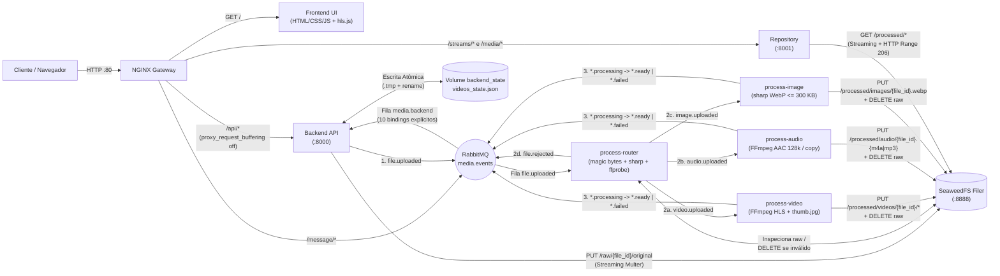
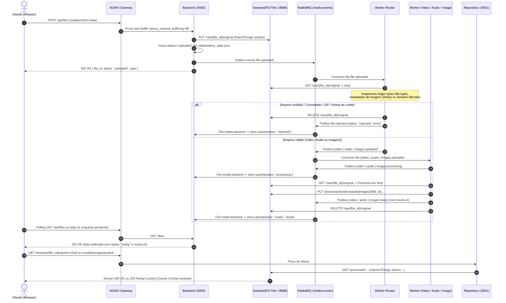

# Repositório de Multimídia

**Sistema Distribuído Orientado a Eventos para Ingestão em Streaming, Validação Binária, Processamento Assíncrono e Entrega de Vídeo (HLS), Áudio (AAC/MP3) e Imagem (WebP)**

---

## 1. Visão Geral

O **Repositório de Multimídia** é uma plataforma distribuída em **Node.js (Express / CommonJS)** que recebe uploads de **vídeos, áudios e imagens**, grava os binários em streaming direto no **SeaweedFS Filer**, classifica e valida os arquivos por *magic bytes*, `sharp` e `ffprobe`, processa cada categoria em workers desacoplados via **RabbitMQ** (com retry exponencial por *Dead-Letter Exchange*) e entrega os artefatos otimizados através de um **Gateway NGINX** com suporte a HLS e HTTP `Range` (`206 Partial Content`).

Para detalhes internos de cada módulo e sequências completas de protocolo, consulte também o documento [arquitetura.md](arquitetura.md).

---

## 2. Arquitetura e Fluxo de Dados

### 2.1 Diagrama de Arquitetura Geral



---

### 2.2 Fluxo de Dados Passo a Passo



#### Detalhamento das 5 Etapas do Pipeline

1. **Ingestão em Streaming (`POST /api/files`)**:
   - O Gateway NGINX recebe o upload na porta `80` com `client_max_body_size 2G` e `proxy_request_buffering off`, repassando o fluxo diretamente ao `backend`.
   - O `backend` usa uma *storage engine* customizada do Multer (`filerMulterStorage`) que gera um `file_id` UUID v4, sanitiza o nome do arquivo e faz `pipe` do stream de entrada diretamente para `PUT http://filer:8888/raw/{file_id}/original`, sem armazenar o arquivo na RAM ou no disco local do backend.
   - O estado inicial (`status: "uploaded"`) é salvo atomicamente em `/data/videos_state.json` (volume `backend_state`) via arquivo temporário `.tmp` + `rename`, e o evento `file.uploaded` é publicado na exchange `media.events`.

2. **Roteamento e Validação Binária (`process-router`)**:
   - Consome `file.uploaded`, baixa o arquivo para `/tmp/videos_download/router_{file_id}` e executa validação em 3 camadas:
     1. **Assinatura Binária (*Magic Bytes*)**: via `file-type`, rejeitando arquivos texto/executáveis com extensão adulterada (ex.: `.txt` renomeado para `.png`) e bloqueando `image/gif`.
     2. **Validação de Imagem (`sharp`)**: verifica limite de `20 MB` (`MAX_IMAGE_SIZE_BYTES`), `limitInputPixels`, dimensões válidas e rejeita imagens animadas (`pages > 1`).
     3. **Validação de Áudio e Vídeo (`ffprobe`)**: inspeciona os fluxos reais do container. Diferencia **vídeo real** de **áudio MP3/M4A com capa de álbum embutida** ignorando streams de vídeo marcados com `disposition.attached_pic === 1`. Valida o codec (`h264`, `hevc`, `av1`, `vp9`, etc.) e os limites de `200 MB` para áudio e `2 GB` para vídeo.
   - Se aprovado, publica `video.uploaded`, `audio.uploaded` ou `image.uploaded`. Se reprovado, apaga `raw/{file_id}/original` do Filer e publica `file.rejected`.

3. **Processamento Especializado (`process-video`, `process-image`, `process-audio`)**:
   - **`process-video` (`WORKER_TYPE=video`)**:
     - Publica `video.processing` → transcodifica o vídeo com FFmpeg para HLS (`-codec:v h264 -codec:a aac -hls_time 4 -hls_list_size 0`) → extrai miniatura `thumb.jpg` (`480px` largura em `00:00:00.500`) → envia `playlist.m3u8`, segmentos `.ts` e `thumb.jpg` para `processed/videos/{file_id}/` no Filer → publica `video.ready` → apaga o arquivo bruto `raw/{file_id}/original`.
   - **`process-image` (`WORKER_TYPE=image`)**:
     - Publica `image.processing` → aplica rotação física conforme tag EXIF (`.rotate()`) e remove metadados EXIF → preserva transparência (canal alpha) → redimensiona (`fit: 'inside', withoutEnlargement: true`, caixa inicial `2048x2048`) e executa busca iterativa nas qualidades `[85, 75, 65, 55, 45]` (reduzindo a caixa em `15%` por rodada até `320px`) até garantir um arquivo **WebP ≤ 300 KB** → grava em `processed/images/{file_id}.webp` → publica `image.ready` → apaga o arquivo bruto.
   - **`process-audio` (`WORKER_TYPE=audio`)**:
     - Publica `audio.processing` → extrai `duration_sec` e tags (`title`, `artist`) via `ffprobe` → aplica 3 regras de decisão:
       1. **MP3 ≤ 128 kbps**: remux sem reencodar (`-vn -c:a copy`), mantendo `.mp3`;
       2. **AAC (M4A/MP4) ≤ 128 kbps**: remux sem reencodar (`-vn -c:a copy -movflags +faststart`), mantendo `.m4a`;
       3. **Demais formatos (`WAV`, `FLAC`, `OGG`) ou bitrate > 128 kbps**: transcodifica para AAC 128 kbps (`-vn -c:a aac -b:a 128k -movflags +faststart`), gerando `.m4a`;
     - Grava em `processed/audio/{file_id}.{mp3|m4a}` → publica `audio.ready` → apaga o arquivo bruto.

4. **Tolerância a Falhas (Retry com Backoff Exponencial via DLX)**:
   - Qualquer erro nos workers aciona `handleWorkerRetryOrFail` (`shared/events.js`): a mensagem é republicada na exchange `media.retry` rumo à fila `media.retry.wait` com `x-retry-count` incrementado (`1`, `2`, `3`) e TTL exponencial (`1000ms`, `2000ms`, `4000ms`).
   - Ao expirar o TTL na `media.retry.wait`, o RabbitMQ devolve a mensagem via `x-dead-letter-exchange: media.events` para a fila original do worker.
   - Esgotadas as 3 tentativas, o worker publica `video.failed`, `audio.failed` ou `image.failed` (ou `file.rejected` no router) com a descrição do erro.

5. **Consolidação de Estado e Entrega (`backend`, `repository` e `frontend`)**:
   - O `backend` consome a fila `media.backend` e atualiza o registro em `backend/store.js` respeitando a **máquina de estados monotônica** (`uploaded [1]` → `processing [2]` → `ready | failed | rejected [3]`), descartando eventos fora de ordem ou regressivos.
   - O `repository` serve `/streams/:videoId/*` e `/media/*` diretamente em streaming a partir do Filer, validando caminhos com `path.posix.resolve` + prefixo, adicionando `Cache-Control: public, max-age=31536000, immutable` e respondendo a cabeçalhos `Range: bytes=...` com `206 Partial Content`.
   - O `frontend` realiza polling automático em `GET /api/files` a cada `3s` somente enquanto existirem itens em `uploaded` ou `processing`, exibindo contadores em tempo real, busca, filtro por abas (`Todos`, `Vídeos`, `Áudios`, `Imagens`) e miniaturas 16:9 para os 3 tipos de mídia.

---

## 3. Contrato de Eventos (RabbitMQ `media.events`)

Exchange do tipo `topic` chamada `media.events`. Lista fechada de **14 eventos explícitos** (nenhum binding utiliza curingas `*` ou `#`):

| Evento | Publicado por | Fila Destino (Consumidor) | Status no Payload | Descrição |
| --- | --- | --- | --- | --- |
| `file.uploaded` | `backend` | `file.uploaded` (`process-router`) | `uploaded` | Upload bruto concluído em `raw/{file_id}/original` |
| `file.rejected` | `process-router` | `media.backend` (`backend`) | `rejected` | Arquivo inválido, corrompido, GIF ou acima do limite (raw apagado) |
| `video.uploaded` | `process-router` | `video.uploaded` (`process-video`) | `uploaded` | Vídeo validado pelo router e `ffprobe` |
| `audio.uploaded` | `process-router` | `audio.uploaded` (`process-audio`) | `uploaded` | Áudio validado pelo router e `ffprobe` |
| `image.uploaded` | `process-router` | `image.uploaded` (`process-image`) | `uploaded` | Imagem validada pelo router e `sharp` |
| `video.processing` | `process-video` | `media.backend` (`backend`) | `processing` | Início da transcodificação HLS |
| `audio.processing` | `process-audio` | `media.backend` (`backend`) | `processing` | Início da otimização/remux de áudio |
| `image.processing` | `process-image` | `media.backend` (`backend`) | `processing` | Início da conversão para WebP |
| `video.ready` | `process-video` | `media.backend` (`backend`) | `ready` | HLS e `thumb.jpg` prontos em `/streams/{file_id}/...` (raw apagado) |
| `audio.ready` | `process-audio` | `media.backend` (`backend`) | `ready` | Áudio pronto em `/media/audio/{file_id}.{m4a\|mp3}` (raw apagado) |
| `image.ready` | `process-image` | `media.backend` (`backend`) | `ready` | Imagem pronta em `/media/images/{file_id}.webp` (raw apagado) |
| `video.failed` | `process-video` | `media.backend` (`backend`) | `failed` | Falha definitiva após 3 tentativas via DLX |
| `audio.failed` | `process-audio` | `media.backend` (`backend`) | `failed` | Falha definitiva após 3 tentativas via DLX |
| `image.failed` | `process-image` | `media.backend` (`backend`) | `failed` | Falha definitiva após 3 tentativas via DLX |

### Exemplo de Payload (`snake_case`)

```json
{
  "event_id": "d290f1ee-6c54-4b01-90e6-d701748f0851",
  "file_id": "3f70d922-9ce2-4e4b-8dc9-4d207fd8497a",
  "type": "image",
  "filename": "foto.png",
  "storage_key": "processed/images/3f70d922-9ce2-4e4b-8dc9-4d207fd8497a.webp",
  "mime_type": "image/webp",
  "original_size": 4613460,
  "occurred_at": "2026-11-03T02:35:46.755Z",
  "status": "ready",
  "result": {
    "url": "/media/images/3f70d922-9ce2-4e4b-8dc9-4d207fd8497a.webp",
    "size": 294852,
    "format": "webp",
    "width": 650,
    "height": 867
  },
  "error": null
}
```

---

## 4. Endpoints HTTP (via Gateway NGINX na Porta 80)

| Método e Rota Externa | Serviço Destino | Descrição |
| --- | --- | --- |
| `GET /` | `frontend:3000` | Interface web do Repositório de Multimídia |
| `GET /healthz` | `gateway:80` | Healthcheck do Gateway NGINX (`200 ok`) |
| `POST /api/files` *(alias `/api/upload`)* | `backend:8000` | Recebe upload `multipart/form-data` (campo `file`) em streaming para o Filer |
| `GET /api/files` *(alias `/api/videos`)* | `backend:8000` | Lista arquivos ordenados do mais recente ao mais antigo (aceita `?type=video\|audio\|image` e `?status=uploaded\|processing\|ready\|failed\|rejected`) |
| `GET /api/files/:id` *(alias `/api/videos/:id`)* | `backend:8000` | Retorna os metadados e estado atual de um arquivo específico |
| `GET /api/files/:id/file` *(alias `/api/videos/:id/file`)* | `backend:8000` | Baixa o arquivo bruto enquanto ainda existir no Filer (`410 Gone` após processado/rejeitado) |
| `GET /streams/:videoId/*` | `repository:8001` | Serve `playlist.m3u8`, segmentos `.ts` e `thumb.jpg` em streaming a partir de `processed/videos/{videoId}/` |
| `GET /media/images/:fileId.webp` | `repository:8001` | Serve a imagem WebP otimizada com `Cache-Control: public, max-age=31536000, immutable` |
| `GET /media/audio/:fileId.{m4a\|mp3}` | `repository:8001` | Serve o áudio otimizado com suporte a `Range` (`206 Partial Content`) e cache imutável |
| `GET /message/` | `rabbitmq:15672` | Interface administrativa do RabbitMQ |

---

## 5. Limites e Formatos Aceitos

| Categoria | Formatos Aceitos (Inspeção Binária) | Limite de Upload | Processamento e Saída |
| --- | --- | --- | --- |
| **Imagem** | `jpeg`, `jpg`, `png`, `webp` *(GIF e imagens animadas são rejeitados)* | `20 MB` (`MAX_IMAGE_SIZE_BYTES`) | `.webp` **≤ 300 KB**, máx. `2048x2048`, auto-orientação EXIF aplicada, metadados EXIF removidos, transparência preservada |
| **Áudio** | `mp3`, `m4a`, `wav`, `flac`, `ogg`, `oga`, `opus` | `200 MB` (`MAX_AUDIO_SIZE_BYTES`) | `.mp3` (remux `-vn -c:a copy` se `mp3 <= 128k`) ou `.m4a` (`-vn -c:a aac -b:a 128k -movflags +faststart`) com `duration_sec` e `tags` |
| **Vídeo** | Containers com stream de vídeo real no `ffprobe` (`h264`, `hevc`, `av1`, `vp8`, `vp9`, `mpeg4`, `prores`, etc.) | `2 GB` (`MAX_VIDEO_SIZE_BYTES`) | HLS (`playlist.m3u8` + segmentos `.ts` de 4s em `h264`/`aac`) + miniatura `thumb.jpg` |

---

## 6. Estrutura de Pastas do Repositório

```text
.
├── arquitetura.md             # Especificação detalhada da arquitetura e fluxos de sequência
├── docker-compose.yml         # Orquestração dos 12 containers locais (SeaweedFS, RabbitMQ, Workers, App, Gateway)
├── shared/
│   ├── events.js              # Contrato dos 14 eventos, topologia AMQP e lógica de retry com backoff (DLX)
│   └── storage.js             # Cliente HTTP em streaming para o SeaweedFS Filer e validação de chaves seguras
├── backend/
│   ├── server.js              # API Express, upload em streaming para o Filer e consumidor da fila media.backend
│   ├── store.js               # Máquina de estados monotônica e persistência atômica em videos_state.json
│   └── test/
│       └── foundation.test.js # Testes unitários de store, topologia de eventos/DLX e storage
├── process/
│   ├── worker.js              # Ponto de entrada parametrizado por WORKER_TYPE e worker de vídeo (HLS + thumb.jpg)
│   ├── router/index.js        # Worker router: inspeção por magic bytes (file-type), sharp e ffprobe
│   ├── image/index.js         # Worker de imagem: conversão para WebP <= 300 KB com sharp
│   ├── audio/index.js         # Worker de áudio: extração de metadados e remux/transcode AAC 128k com FFmpeg
│   └── test/                  # Testes unitários do router, imagem e áudio
├── repository/
│   └── server.js              # Entrega de /streams/* e /media/* com cache imutável e HTTP Range (206)
├── frontend/
│   ├── index.html             # Interface web em 2 colunas (Upload + Palco Multimídia e Galeria com Filtros)
│   ├── style.css              # Estilização responsiva mantendo a paleta clara original (#f4f4f9 / #0066cc)
│   └── app.js                 # Lógica de upload, preview local, miniaturas 16:9 (Canvas/WebP/FFmpeg) e polling
├── nginx/
│   ├── nginx.conf.template    # Gateway reverso com DNS dinâmico (resolver 127.0.0.11) e streaming sem buffer
│   └── docker-entrypoint.sh   # Substituição de variáveis de ambiente via envsubst
├── rabbitMQ/
│   └── EVENTOS.txt            # Resumo da topologia e contrato de eventos AMQP
└── infra/deploys/
    ├── process.yaml           # 4 Deployments + 4 ScaledObjects KEDA (router, video, audio, image)
    ├── repository.yaml        # Deployment e Service K3s do repository
    ├── gateway.yaml           # DaemonSet K3s do gateway NGINX
    ├── storage.yaml           # PersistentVolume e PersistentVolumeClaim de referência
    └── monitoring.yaml        # DaemonSet de monitoramento de nós (node-exporter + healthcheck K3s)
```

---

## 7. Como Executar e Testar

### 7.1 Configurar Variáveis de Ambiente

Copie os arquivos `.env.example` para `.env` em cada módulo:

```bash
cp rabbitMQ/.env.example rabbitMQ/.env
cp backend/.env.example backend/.env
cp process/.env.example process/.env
cp repository/.env.example repository/.env
cp frontend/.env.example frontend/.env
cp nginx/.env.example nginx/.env
```

Defina a mesma senha para o usuário do RabbitMQ em `rabbitMQ/.env`, `backend/.env` e `process/.env` (substituindo `CHANGE_ME`).

### 7.2 Subir todos os Serviços com Docker Compose

```bash
docker compose up -d --build
```

- **Interface Web (Gateway NGINX)**: `http://localhost`
- **API REST de Arquivos**: `http://localhost/api/files`
- **Painel de Gerenciamento do RabbitMQ**: `http://localhost/message/`

### 7.3 Executar a Suíte de Testes Unitários

```bash
node --test backend/test/foundation.test.js process/test/router.test.js process/test/image.test.js process/test/audio.test.js
```
