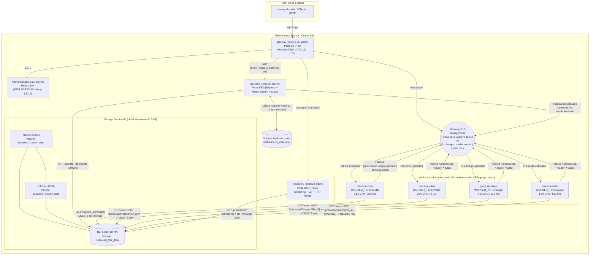
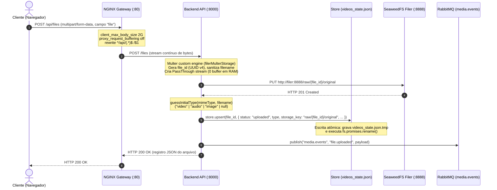
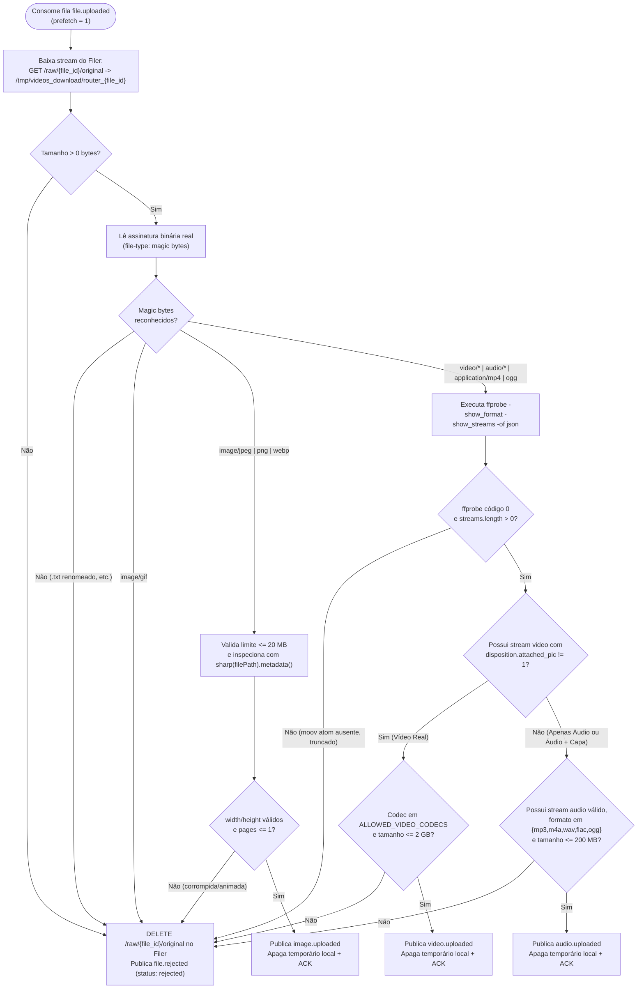
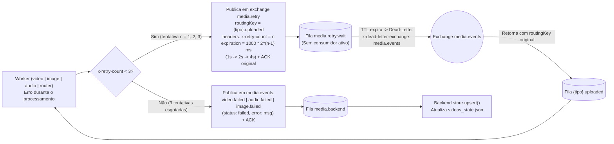
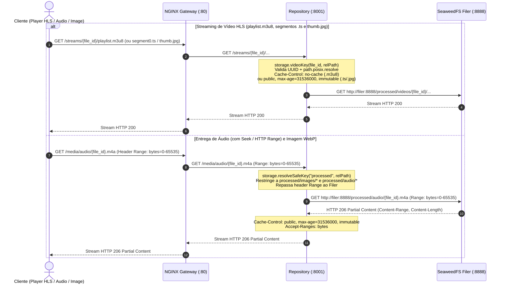

# Arquitetura e Fluxo de Dados — Repositório de Multimídia

Atualizado em: 2026-11-03  
Estado refletido: Código em produção na branch `fase-5-final` (validado por 17 testes automatizados e suíte E2E em containers Docker).

---

## 1. Visão Geral da Topologia de Serviços

O sistema é composto por **12 containers** orquestrados via Docker Compose (e manifestos equivalentes para K3s + KEDA em `infra/deploys/`). Apenas o **Gateway NGINX** expõe porta para o host (`80:80`); todos os demais serviços comunicam-se exclusivamente pela rede interna isolada.



### Inventário de Serviços (`docker-compose.yml`)

| Container (`container_name`) | Serviço | Imagem Base | Porta Interna | Recursos / Limites | Volumes / Persistência |
| --- | --- | --- | --- | --- | --- |
| `repositorio-multimidia-gateway` | `gateway` | `nginx:1.25-alpine` | `80:80` (Pública) | — | — |
| `repositorio-multimidia-frontend` | `frontend` | `nginx:1.25-alpine` | `3000` | — | Estáticos em `/usr/share/nginx/html` |
| `repositorio-multimidia-backend` | `backend` | `node:20-alpine` | `8000` | UID `1000:1000` | `backend_state:/data` (`videos_state.json`) |
| `repositorio-multimidia-repository` | `repository` | `node:20-alpine` | `8001` | UID `1000:1000` | — (stateless; lê direto do `filer`) |
| `repositorio-multimidia-process-router` | `process-router` | `node:20-bookworm-slim` | — | `0.50 CPU` / `256M`, UID `1000:1000` | `/tmp/videos_download` (efêmero, limpo a cada job) |
| `repositorio-multimidia-process-video` | `process-video` | `node:20-bookworm-slim` | — | `2.00 CPU` / `2G`, UID `1000:1000` | `/tmp/hls`, `/tmp/videos_download` (efêmeros) |
| `repositorio-multimidia-process-image` | `process-image` | `node:20-bookworm-slim` | — | `1.00 CPU` / `512M`, UID `1000:1000` | `/tmp/videos_download` (efêmero) |
| `repositorio-multimidia-process-audio` | `process-audio` | `node:20-bookworm-slim` | — | `1.00 CPU` / `512M`, UID `1000:1000` | `/tmp/videos_download` (efêmero) |
| `repositorio-multimidia-rabbitmq` | `rabbitmq` | `rabbitmq:3.13-management` | `5672`, `15672` | Healthcheck `rabbitmq-diagnostics ping` | Estado interno do broker |
| `repositorio-multimidia-seaweed-master` | `master` | `chrislusf/seaweedfs:3.65` | `9333` | Healthcheck `/cluster/status` | `seaweed_master_data:/data` |
| `repositorio-multimidia-seaweed-volume` | `volume` | `chrislusf/seaweedfs:3.65` | `8080` | Healthcheck `/status` | `seaweed_volume_data:/data` |
| `repositorio-multimidia-seaweed-filer` | `filer` | `chrislusf/seaweedfs:3.65` | `8888` | Healthcheck `http://127.0.0.1:8888/` | `seaweed_filer_data:/data` |

---

## 2. Fluxo de Dados Completo (Fim a Fim)

### Etapa 1 — Ingestão em Streaming (`Cliente → Gateway → Backend → SeaweedFS Filer → RabbitMQ`)



1. **Recepção sem Buffering em Disco/RAM**:
   - O Gateway NGINX recebe `POST /api/files` com `proxy_request_buffering off` e `client_max_body_size 2G` (`nginx/nginx.conf.template`), repassando os chunks imediatamente para `backend:8000/files`.
   - No `backend/server.js`, a engine `filerMulterStorage` intercepta `file.stream`, gera um `file_id` UUID v4 puro, sanitiza o nome original (`storage.sanitizeFilename`, removendo diretórios, caracteres de controle e truncando em 200 caracteres) e canaliza (`pipe`) o `PassThrough` direto para `storage.put("raw/{file_id}/original", pass)` via HTTP `PUT` no SeaweedFS Filer.
   - Caso a conexão caia ou o arquivo ultrapasse `MAX_UPLOAD_BYTES` (`2 GB`), o bloco `.catch` remove qualquer objeto parcial em `raw/{file_id}/original` no Filer e retorna `413 Payload Too Large` quando `err.code === 'LIMIT_FILE_SIZE'`.
2. **Registro Inicial e Evento**:
   - O backend infere o tipo preliminar (`guessInitialType` por MIME ou extensão) para que a interface já posicione o item na aba correspondente enquanto aguarda a inspeção binária.
   - `store.upsert` persiste o registro com `status: "uploaded"` em `/data/videos_state.json` de forma atômica (grava em `/data/videos_state.json.tmp` e faz `rename` POSIX).
   - O backend publica o evento `file.uploaded` na exchange topic `media.events`.

---

### Etapa 2 — Inspeção Binária e Roteamento (`RabbitMQ → process-router → Filer → RabbitMQ`)



- **Nunca confia na extensão nem no `Content-Type` enviado pelo cliente**: um arquivo `.txt` ou executável renomeado para `.png` ou `.mp4` é barrado em `detectMagicBytes` ou no `ffprobe`/`sharp`.
- **Diferenciação entre Vídeo Real e Áudio com Capa de Álbum (`attached_pic`)**: arquivos `.mp3` ou `.m4a` frequentemente embutem uma imagem JPEG/PNG como stream de vídeo (`codec_name: mjpeg`, `disposition.attached_pic: 1`). O filtro em `process/router/index.js` ignora streams com `attached_pic === 1` ao procurar vídeo, classificando corretamente a faixa como `audio`.
- **Limpeza imediata de arquivos rejeitados**: quando qualquer validação falha, o router executa `storage.delete("raw/{file_id}/original")` no Filer e publica `file.rejected` com a razão exata no campo `error`.

---

### Etapa 3 — Processamento Especializado por Tipo de Mídia

#### 3.1 Worker de Vídeo (`process-video` — `process/worker.js`)

1. Consome a fila `video.uploaded` (`prefetch(1)`).
2. Publica `video.processing` (`status: "processing"`), que chega ao backend pela fila `media.backend`.
3. Baixa `raw/{file_id}/original` do Filer para `/tmp/videos_download/{file_id}`.
4. Executa o **FFmpeg** para transcodificação HLS em `/tmp/hls/{file_id}/`:
   ```bash
   ffmpeg -y -i <input> -codec:v h264 -codec:a aac -start_number 0 -hls_time 4 -hls_list_size 0 -f hls playlist.m3u8
   ```
5. Extrai um frame em `00:00:00.500` redimensionado para largura `480px` mantendo proporção (`-vf scale=480:-2 -q:v 4`) gerando `thumb.jpg`.
6. Envia `playlist.m3u8`, todos os segmentos `.ts` e `thumb.jpg` em streaming para `processed/videos/{file_id}/...` no Filer.
7. Publica `video.ready` com:
   - `storage_key: "processed/videos/{file_id}/playlist.m3u8"`
   - `result: { url: "/streams/{file_id}/playlist.m3u8", size: totalSize, format: "hls", thumbnail_url: "/streams/{file_id}/thumb.jpg" }`
8. Remove o arquivo bruto `raw/{file_id}/original` do Filer e apaga `/tmp/hls/{file_id}` e `/tmp/videos_download/{file_id}`.

#### 3.2 Worker de Imagem (`process-image` — `process/image/index.js`)

1. Consome a fila `image.uploaded` (`prefetch(1)`).
2. Publica `image.processing` (`status: "processing"`).
3. Baixa `raw/{file_id}/original` do Filer para `/tmp/videos_download/image_{file_id}`.
4. Executa `compressImageToWebp` com `sharp` (`limitInputPixels: 268402689`):
   - Lê metadados, rejeita GIFs ou imagens multi-página (`pages > 1`) e detecta rotação EXIF (`orientation` 5 a 8 trocam os eixos `width`/`height`).
   - Define a caixa máxima inicial `targetBoundingBox = Math.min(2048, longestSide)`.
   - Para cada caixa (reduzindo `15%` por rodada até o piso de `320px`), testa as qualidades WebP `[85, 75, 65, 55, 45]` com `.rotate()` (aplica orientação física nos pixels e remove metadados EXIF), `.resize({ width: box, height: box, fit: 'inside', withoutEnlargement: true })` e preservação de canal alpha (`alphaQuality: quality`).
   - Assim que o buffer resultante atinge `<= 300 KB` (`307.200 bytes`), encerra a busca.
5. Grava o buffer otimizado em `processed/images/{file_id}.webp` no Filer.
6. Publica `image.ready` com:
   - `storage_key: "processed/images/{file_id}.webp"`
   - `result: { url: "/media/images/{file_id}.webp", size, format: "webp", width, height }`
7. Remove o arquivo bruto `raw/{file_id}/original` do Filer e limpa o arquivo temporário local.

#### 3.3 Worker de Áudio (`process-audio` — `process/audio/index.js`)

1. Consome a fila `audio.uploaded` (`prefetch(1)`).
2. Publica `audio.processing` (`status: "processing"`).
3. Baixa `raw/{file_id}/original` do Filer para `/tmp/videos_download/audio_in_{file_id}`.
4. Inspeciona o arquivo com `ffprobe` (`extractAudioMetadata`), extraindo `codec`, `formatName`, `bitrate`, `durationSec` e tags normalizadas (`title`, `artist`).
5. Aplica os **3 ramos de decisão** (`decideAudioTranscodePlan`):
   - **Ramo 1 (`copy_mp3`)**: se `codec === 'mp3'` e `0 < bitrate <= 128000` → executa apenas remux sem reencodar (`ffmpeg -y -i in -vn -c:a copy out.mp3`), descartando trilhas de vídeo/capa (`-vn`) e mantendo extensão `.mp3`.
   - **Ramo 2 (`copy_m4a`)**: se `codec === 'aac'` em container M4A/MP4/MOV e `0 < bitrate <= 128000` → executa remux rápido (`ffmpeg -y -i in -vn -c:a copy -movflags +faststart out.m4a`), movendo o átomo `moov` para o início do arquivo.
   - **Ramo 3 (`transcode_aac_128k`)**: para `wav`, `flac`, `ogg`, `opus` ou `mp3`/`aac` com bitrate `> 128 kbps` → transcodifica para AAC a `128 kbps` (`ffmpeg -y -i in -vn -c:a aac -b:a 128k -movflags +faststart out.m4a`).
6. Envia o arquivo final em streaming para `processed/audio/{file_id}.{mp3|m4a}` no Filer.
7. Publica `audio.ready` com:
   - `storage_key: "processed/audio/{file_id}.{mp3|m4a}"`
   - `result: { url: "/media/audio/{file_id}.{mp3|m4a}", size, format: "mp3" | "m4a", duration_sec, tags: { title, artist } }`
8. Remove o arquivo bruto `raw/{file_id}/original` do Filer e limpa os arquivos temporários locais.

---

### Etapa 4 — Retry com Backoff Exponencial (DLX) e Máquina de Estados no Backend



#### Máquina de Estados Monotônica (`backend/store.js`)

O módulo `store.js` atribui um ranking numérico a cada estado e bloqueia qualquer transição regressiva ou alteração pós-estado terminal (exceto reprocessamento idempotente do mesmo estado):

| Estado (`status`) | Ranking (`STATUS_RANK`) | Terminal? | Transições Permitidas a partir dele |
| --- | --- | --- | --- |
| `uploaded` | `1` | Não | `uploaded`, `processing`, `ready`, `failed`, `rejected` |
| `processing` | `2` | Não | `processing`, `ready`, `failed`, `rejected` (ignora `uploaded` atrasado) |
| `ready` | `3` | **Sim** | Apenas `ready` (atualização idempotente do mesmo `file_id`; ignora `uploaded`, `processing`, `failed`, `rejected`) |
| `failed` | `3` | **Sim** | Apenas `failed` |
| `rejected` | `3` | **Sim** | Apenas `rejected` |

---

### Etapa 5 — Entrega de Mídia, Streaming HLS e HTTP Range (`Cliente → Gateway → Repository → Filer`)



---

## 3. Esquema de Chaves no SeaweedFS Filer (`shared/storage.js`)

Todas as chaves no Filer são determinísticas e baseadas exclusivamente no `file_id` (UUID v4 validado por regex), **nunca** incluindo o nome original enviado pelo usuário no caminho do storage:

| Prefixo / Padrão | Função | Ciclo de Vida |
| --- | --- | --- |
| `raw/{file_id}/original` | Arquivo bruto recém-enviado no upload (`POST /files`) | **Temporário**: removido automaticamente após `video.ready`, `image.ready`, `audio.ready` ou `file.rejected`. Enquanto existe, pode ser baixado em `GET /api/files/:id/file` (após removido, a rota retorna `410 Gone`). |
| `processed/videos/{file_id}/playlist.m3u8` | Manifesto principal HLS gerado pelo `process-video` | **Permanente**: servido em `/streams/{file_id}/playlist.m3u8` (`Cache-Control: no-cache`). |
| `processed/videos/{file_id}/playlist*.ts` | Segmentos de vídeo/áudio (`h264`/`aac` de 4s) | **Permanente**: servidos em `/streams/{file_id}/playlist*.ts` (`Cache-Control: public, max-age=31536000, immutable`). |
| `processed/videos/{file_id}/thumb.jpg` | Miniatura JPEG (`480px` largura) extraída em `0.5s` | **Permanente**: servida em `/streams/{file_id}/thumb.jpg` (`Cache-Control: public, max-age=31536000, immutable`). |
| `processed/images/{file_id}.webp` | Imagem convertida para WebP (`<= 300 KB`, máx. `2048x2048`, sem EXIF) | **Permanente**: servida em `/media/images/{file_id}.webp` (`Cache-Control: public, max-age=31536000, immutable`). |
| `processed/audio/{file_id}.{m4a\|mp3}` | Áudio otimizado (`.mp3` copy `<= 128k` ou `.m4a` AAC `128k +faststart`) | **Permanente**: servido em `/media/audio/{file_id}.{m4a\|mp3}` com suporte a `Range` (`206 Partial Content`). |

---

## 4. Escalabilidade em Kubernetes (K3s + KEDA — `infra/deploys/`)

No ambiente Kubernetes (`infra/deploys/process.yaml`), cada `WORKER_TYPE` possui seu próprio `Deployment` e `ScaledObject` do **KEDA** monitorando a profundidade da fila no RabbitMQ:

| Deployment K3s | `WORKER_TYPE` | Fila Monitorada | `minReplicaCount` | `maxReplicaCount` | Gatilho (`QueueLength`) | Recursos (Requests → Limits) |
| --- | --- | --- | --- | --- | --- | --- |
| `repositorio-multimidia-process-router` | `router` | `file.uploaded` | `1` (sem *cold start* na triagem) | `5` | `5` mensagens/pod | `100m / 128Mi` → `500m / 256Mi` |
| `repositorio-multimidia-process-video` | `video` | `video.uploaded` | `0` (*scale-to-zero*) | `10` | `1` mensagem/pod | `500m / 512Mi` → `2000m / 2Gi` |
| `repositorio-multimidia-process-audio` | `audio` | `audio.uploaded` | `0` (*scale-to-zero*) | `8` | `2` mensagens/pod | `200m / 256Mi` → `1000m / 512Mi` |
| `repositorio-multimidia-process-image` | `image` | `image.uploaded` | `0` (*scale-to-zero*) | `8` | `3` mensagens/pod | `200m / 256Mi` → `1000m / 512Mi` |
